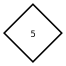
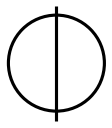
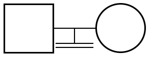

# Pedigree Standard

## File format

Pedigree are usually stored as text file, tab-separated value id the most common, but space, multiple-spaces or commas are also possible separators. There is one row per individual.

Files are read as UTF-8 on every platform (a byte order mark, as Excel's "CSV UTF-8" writes, is ignored); a file in another encoding is a parse error asking to save it as UTF-8.

They are made of 6 columns:

- the **family_id** or **fid**: the family unique identifier
- the **sample_id** or **iid**: an individual sample identifier
- the **paternal_id** or **father**: the sample identifier of the father
- the **maternal_id** or **mother**: the sample identifier of the mother
- the **sex**: the biological sex of the individual designed by the *sample_id* (1 = male, 2 = female, 0 or -9 = unknown)
- the **phenotype**: a phenotypic value that can be binary (1 = unaffected, 2 = affected, 0 or -9 = unknown)

For robustness we will treat `0` or `nan` in the paternal_id and/or maternal_id column as no information available.

A parent named in the father or mother column but with no row of their own is drawn as a phantom: dashed outline, labelled with that ID, sex from the role, and a `PedigreeDataWarning` says so. A child with only one parent given gets an unlabelled phantom for the other. Either way the child hangs from both parents, as with `PedigreeBuilder`; a `.fam` export leaves phantoms out.

### Extended format

Additional columns can be appended to the standard 6-column format. All extended columns are optional — the parser auto-detects how many columns are present.

- 7th column: **date_of_birth** (dob) using a format that could be YYYYMMDD or YYYYMM or YYYY but should be uniform across the file. Use `0` or `-9` for unknown. It is used only to order siblings, oldest on the left, and is compared as text: a shorter date sorts before a longer one that starts with it (`1990` before `199003`), which is why one precision for the whole file is best. Siblings with no date are drawn after the dated ones, in file order; with no date at all, siblings keep the file order. For a pregnancy row (`pregnancy` P, SAB, TOP, ECT or SB), give the date of its outcome (the loss, termination or stillbirth); for an ongoing pregnancy (P), its expected due date, so that it is drawn after its born siblings. The SVG tooltip shows the value as given ("DOB: ...").
- 8th column: **twins** — a comma-separated list of values describing twin relationships:
  - `MZ:sample_id` to indicate that `sample_id` is a monozygotic twin to the current individual
  - `DZ:sample_id` to indicate that `sample_id` is a dizygotic twin to the current individual
  - `TW:sample_id` to indicate that `sample_id` is a twin of unknown zygosity to the current individual
  - Use `0` or `-9` for no twin information.
- 9th column: **deceased** — whether the individual is deceased (1 = deceased, 0 = alive). Use `0` or `-9` for unknown/alive.
- 10th column: **proband** — whether the individual is the proband, i.e. the family member at the origin of the medical consultation (1 = proband, 0 = not proband). Use `0` or `-9` for not proband.

### Inline phenotypes

When a **header row is present**, the parser uses **smart column mapping** to detect phenotype columns:

- Column names are matched against known structural names (FID, ID, Father, Mother, Sex, Phenotype, DOB, Twins, Deceased, Proband, Carrier) with multiple aliases supported.
- Any unrecognised column name after the core 5 (FID, ID, Father, Mother, Sex) is treated as an **extra phenotype column**.
- If no explicit `Phenotype` column is present, the first extra phenotype column is used as the primary affected/unaffected status.
- This means **you don't need the full 10-column format** — phenotype columns can appear directly after Sex.

Phenotype types:

- **Binary phenotypes**: values use standard pedigree encoding — `2`=affected (color band), `1`=unaffected (white band), `0`=unknown (grey band), `-9`=no data (grey band with "NA" text, the grey of `0` told apart by the text; `--no-na-labels` or the `show_na_labels` style option removes the text). When all bands for an individual are NA (`-9`), a single centered "NA" is shown instead of repeating per band.
- **Quadrant layout** (the default since 0.5.0): each symbol is cut in four and each phenotype column, or `cr_` carrier source, fills one quadrant instead of a horizontal band, up to four columns. With more, the default (`phenotype_layout: "auto"`) draws bands; `--phenotype-layout quadrants` does the same with a warning, and `--phenotype-layout bands` always draws bands. Carrier sources alone, with no phenotype column, are drawn as with bands. A single source (one phenotype column, no carrier column) fills the whole symbol under "auto", as NSGC draws one condition (since 0.11.0). The same codes apply: color, white, grey, grey with "NA".
- **Conventional phenotypes**: columns named for autism (`Autism`, `ASD`, `TSA`), intellectual disability (`ID`, `DI`, `Intellectual disability`), ADHD (`ADHD`, `TDAH`) or epilepsy (`Epilepsy`, `Épilepsie`), whatever their prefix and case, are drawn blue, red, yellow and purple, and take the top-left, bottom-left, top-right and bottom-right quadrants. A color in `phenotype_colors` or a quadrant in `phenotype_quadrants` overrides them.
- **Continuous phenotypes**: numeric values > 2 — rendered as color gradients (min→white, max→full color).
- **Missing values**: empty, `.`, `NA`, `NaN` — treated as `-9` (no data).
- **Not applicable**: `N/A`, `not_applicable` or `not applicable` (case-insensitive) in a binary, gradient, binned or categorical column says the phenotype cannot apply to that individual (ovarian cancer for someone assigned male at birth, prostate cancer for someone assigned female at birth, an adult-onset measure for a child). `NA` keeps meaning no data. The band or quadrant is white, as for unaffected, with no text and no legend row (0.10.0 crossed it with a grey diagonal, which read as the deceased line on every sex-limited cancer, #120); the SVG tooltip reads "ovarian cancer: not applicable". It is not data: it does not count in a gradient's range or make a column categorical. A symbol whose bands are all no data or not applicable gets one centred "NA" when at least one is no data, none when all are not applicable. Read in the pedigree file, a DataFrame and `PedigreeBuilder` (`phenotypes={"OC": "N/A"}`), and in `cr_` carrier columns (carrier status of an X-linked condition for a man): the section is white, not grey with "NA" (#121); a separate `--pheno` file reads it as no data. `pd.read_csv` turns `N/A` into NaN (no data) by default: read with `keep_default_na=False, na_values=["NA", ""]` to keep it.
- **PGS scale**: By default (since 0.10.0) a PGS value is a z-score, e.g. standardised in an ancestry-matched reference population as CanRisk, the PGS Catalog's calculator or a pTDT analysis give it, placed on the drawn standard normal (`pgs_scale: "zscore"`). If a PGS column does not look like z-scores (a value beyond ±5; or, with at least 2 values not all 0, every value within ±0.05, as raw PLINK scores are; or, with at least 5 values, a standard deviation under 0.05; or, with at least 3 values, a mean beyond ±2; a person drawn twice counts once, #117), a warning suggests `--pgs-scale minmax` (style `"pgs_scale": "minmax"`), which places each value between the pedigree's lowest and highest score, for raw scores: that position says nothing about the population. With `percentile` the value is a population percentile (0-100). On the fixed scales the curve's +/-2 SD tails are marked with dotted lines, values beyond the box are clipped to its edge, the legend names the scale, and the SVG tooltip gives z and percentile ("z = +1.10, 86th percentile"). PGS curves are drawn even when the pedigree has no other phenotype column.
- **PGS columns**: any column whose name starts with `PGS` (case-insensitive) is treated as a PGS column -- e.g. `PGS`, `PGS_autism`, `PGS_IQ`. Multiple PGS values are displayed on a single gaussian curve with distinct colored markers. Marker colors are controlled by the `pgs_colors` style option. Markers whose values are too close to tell apart have their dots set side by side; `show_pgs_values` (`--show-pgs-values`) writes each value beside its marker. With several PGS columns and no `pgs_colors` entry, each gets its own color: a score named after a known phenotype (`PGS_autism`, `PGS_ADHD`, `PGS_ID`, `PGS_epilepsy`) takes that phenotype's color, the one its column has in the figure if there is one; the others take the first color unlike the other scores and the phenotype bands, starting from `#e74c3c`. A single PGS column keeps `#e74c3c`. `pgs_colors` entries always win. When PGS columns are present, `couple_gap` and `sibling_gap` auto-increase to accommodate the curve. The curve goes left of the symbol, or right of it for the right-hand partner of a couple, off the line between partners. The curve stands upright in its box, values growing upward, its baseline on the right and its peak to the left: turned a quarter turn clockwise it is the usual bell, positive values on the right, as in the legend (#126).
- **pTDT deviations** (#52): a column whose name starts with `pTDT` (case-insensitive, e.g. `pTDT_autism`) holds each child's polygenic transmission deviation, (PGS_child − PGS_mid-parent) / SD(PGS_mid-parent) (Weiner et al. 2017), N(0, 1) without over-transmission. It is drawn with the PGS curve, always on the z scale whatever `pgs_scale` (±2 SD marked), captioned "pTDT" under the curve; the legend has its own row, "pTDT deviation, (child − mid-parent) / SD, ±2 SD marked:" then its key, and the SVG tooltip reads "pTDT = +2.12" (no percentile). Each kind of curve has its own box (since 1.0.0rc3): a child with both a PGS and a pTDT deviation (as with `--ptdt`) shows a PGS box and a pTDT box side by side. `pTDT_autism` may take the color `PGS_autism` has. Give them in the file, or let pypedigree compute them (since 0.11.0): with `pgs_transmission` (`--ptdt`), each child whose two parents have a value of a `PGS_*` column gets (child − mid-parent) / `ptdt_midparent_sd` in a `pTDT_*` column (`PGS_autism` → `pTDT_autism`). SD(mid-parent) is a cohort quantity one family cannot estimate: √½ by default, the value for standardised scores and unrelated parents. A child missing a parent or a value gets none (its PGS box only); a `pTDT_*` column already in the file is drawn as given, with a warning. The parsed pedigree is not modified.
- **Traits on a curve** (`z_` prefix, since 1.0.0rc3): a column named `z_IQ` is drawn as a PGS is, a marker on a normal curve in a box beside the symbol, for any normally distributed quantitative trait. Its values are z-scores, or give the population's mean and SD in the style, `"curve_reference": {"IQ": {"mean": 100, "sd": 15}}`: the marker is then at z = (value − mean) / SD, the value is written as it is ("115", with `show_pgs_values`), and the SVG tooltip reads "IQ: 115 (z = +1.00, 84th percentile)". Without a reference, values that do not look like z-scores draw the warning PGS columns get. The box is captioned with the column's name ("IQ"); `curve_captions` changes it, and columns given one caption share one box, one marker each, as several PGS do (`{"IQ_verbal": "IQ", "IQ_performance": "IQ"}`). A column listed in `curve_reference` or `curve_captions` is drawn on a curve whatever its prefix. Each kind of curve (PGS, pTDT, IQ...) has its own box: an individual with values of several gets their boxes in a row, outward from the symbol, in column order, and the layout keeps room for the most boxes one individual has. The legend has a row per kind, e.g. "IQ distribution (mean 100, SD 15)", with the ±2 SD lines of the box's scale. `pgs_scale` applies to PGS columns only.
- **SVG hooks**: A `css_class` column (classes separated by spaces or commas) and `data_` columns (`data_qc` → `data-qc`, `_` becoming `-`) do not draw anything: they add classes and `data-*` attributes to the individual's node in the interactive SVG, for the host page's stylesheet and scripts (`.node.flagged`, `[data-qc="high"]`). Empty, `.` or `NA` leave them out; `0` and `-9` are kept as values. Class names must be CSS identifiers, and `node` and `dimmed` are used by the SVG itself; `data-id`, `data-parents`, `data-children`, `data-siblings`, `data-x`, `data-y` and `data-size` are written by pypedigree. Any other name raises `PedigreeParseError` with the line.
- **Not sampled**: A `not_sampled` column (aliases `inferred`, `unsampled`, `dummy`; `1`, `yes` or `true`) marks individuals who have a row but were never sampled or sequenced, such as the "dummy" parents or grandparents that link real members. They are drawn with a dashed outline, like a phantom parent, but keep their label, parents, phenotypes and their place in a `.fam` export; the SVG tooltip says "Not sampled (inferred)".
- **Annotation columns**: columns with the `a_` prefix (e.g. `a_Role`, `a_Clinic`) are annotation columns. Their values are displayed as italic grey text below the individual's ID label. Missing values (0, -9, NA, empty) produce no annotation line. Annotations can also be loaded from a separate file via the `--annotations` CLI option.
- **Comma decimal separator**: the parser accepts comma as decimal separator for European locales (e.g. `0,712` is parsed as `0.712`).

### Column name prefixes

Column name prefixes control how phenotype columns are rendered:

| Prefix | Mode | Rendering |
|--------|------|-----------|
| `b_` | Binary | Color (affected) / white (unaffected) / grey (unknown) / NA (no data) bands |
| `g_` | Gradient | White to color continuous gradient with value labels |
| `gi_` | Gradient Inverted | Color to white gradient (high value = white, low value = full color). Useful for metrics where low = bad (e.g., IQ). |
| `o_` | Outline | Colored shape border (not a band) |
| `c_` | Categorical | Distinct color per unique string value |
| `cr_` | Carrier | Carrier status of one gene or condition: `0` not a carrier, `1` carrier, `2` obligate carrier, `-9`/`NA` unknown. Drawn as a patterned section of the symbol |
| `a_` | Annotation | Text displayed below the ID label (italic grey), not a phenotype band |
| *(none)* | Auto | Auto-detect from data (default) |

The prefix is stripped from the display name (e.g. `b_ASD` is shown as `ASD`), and underscores are shown as spaces (`b_intellectual_disability` as "intellectual disability"). The style option `phenotype_labels` gives any column another name, e.g. `{"SRS": "SRS T-score"}`.

### Style JSON options for gradients

The style JSON supports additional gradient configuration:

- **`gradient_range`**: custom min/max for gradient normalization. Example: `{"SRS": [40, 90]}` normalizes SRS values between 40 and 90.
- **`gradient_diverging`**: tricolor diverging gradient. Values below the midpoint blend from `color_low` to white; values above blend from white to `color_high`. Example: `{"IQ": {"min": 40, "mid": 100, "max": 160, "color_low": "#e74c3c", "color_high": "#2ecc71"}}`.

Gradient band values (e.g. "IQ: 90") are written whatever the band's color intensity. Text in bands and quadrants fits its place (`band_text: "auto"`, the default since 0.7.0): a gradient band writes "IQ: 90", or "90" alone, or the value smaller (down to `min_font_size`, or half `font_size`), whichever first fits the band's width at that height (a circle's chord), and nothing when even that does not fit; quadrant text likewise. `band_text: "name_value"` always writes "IQ: 90" (as before 0.7.0), `"value"` the value alone, `"none"` no value.

Example — compact format (phenotypes directly after Sex):

```
FID	ID	Father	Mother	Sex	ASD	Dyslexia
FAM1	child	father	mother	2	1	2
FAM1	father	0	0	1	2	1
```

Example — full 10-column format with extras:

```
FID	IID	PAT	MAT	SEX	PHENO	DOB	TWINS	DECEASED	PROBAND	epilepsy	IQ	SRS	PGS
mockup	1	0	0	1	2	0	0	0	0	1	105	62	0.72
mockup	2	0	0	2	1	0	0	0	0	0	118	45	0.35
```

### Separate phenotype file (.pheno)

Phenotype data can also be provided as a separate TSV file via the `--pheno` CLI option. Format: first column is `sample_id`, subsequent columns are phenotype values. A header row is required.

```
sample_id	epilepsy	IQ	SRS
father	1	118	45
mother	1	92	78
child	2	105	62
```

Rows are matched to the pedigree by `sample_id`. Sample IDs that match no
individual are listed in a warning (`PedigreeDataWarning`, `Warning: …` on the
CLI) and their values are ignored; an individual with no row is drawn with
"NA" bands.

### Standard notation columns

With a header row, these columns are recognised by name (case-insensitive).
Their codes are case-insensitive; `0`, `-9`, `NA`, `.` or an empty cell mean
nothing to note, and any other value is an error naming the line.

- **pregnancy** (aliases `pregnancy_outcome`, `outcome`): `P` ongoing pregnancy,
  `SAB` spontaneous abortion (miscarriage), `TOP` termination of pregnancy, `ECT`
  ectopic pregnancy, `SB` stillbirth. Long forms are accepted (`miscarriage`,
  `termination`, `ectopic`, `stillbirth`).
- **adopted** (alias `adoption`): `in` (or `1`) when the parents given are the
  adoptive parents, `out` (or `2`) when they are the biological parents of a
  child adopted out.
- **childless** (aliases `childlessness`, `infertility`): `choice` (or `1`) for
  no children by choice or for an unknown reason, `infertility` (or `2`).
- **art** (alias `assisted_reproduction`): `D` gamete (egg or sperm) donor, `S`
  surrogate (`GC`, gestational carrier, is accepted too).
- **gender_identity** (alias `identity`): `man` (`M`, `1`), `woman` (`F`, `W`,
  `2`), `nonbinary` (`NB`, `X`, `3`). When it is given, the `sex` column is read
  as the sex assigned at birth. A column named `gender` is the gender identity
  only when the header also has a `sex` column; alone it is the sex column.
- **consultand**: `1` for the consultand (the person seeking counselling, when
  that is not the proband).
- **evaluated** (aliases `documented_evaluation`, `evaluation`): `1`, `yes` or `true` for a
  documented evaluation, records reviewed: an asterisk at the lower right of the symbol
  (Bennett et al. 2022, Figure 2). Any other text marks it too and is the evaluation's result, written
  below the symbol (e.g. `WGS: negative`); the 2022 revision dropped the "E" prefix.

Gestational age, karyotype, the reason for infertility and similar details go in
`a_` annotation columns.

## CanRisk files

pypedigree reads the pedigree files of the CanRisk tool (BOADICEA model; formats 1 to 4, current
since CanRisk 4.0), recognised by their first line, `##CanRisk 4.0` (or `2.0`, `3`, ...), from the
CLI, `parse_pedigree()`, `parse_pedigree_from_string()` and the web app. A file may hold several
families, each with its own `##CanRisk` header block. Columns are read by the names of the
`##FamID ...` line, so every version is read by the same code (v1 has no `BARD1`, v2 and v3 no
`HOXB13`).

| CanRisk | pypedigree |
|---|---|
| `FamID`, `IndivID`, `FathID`, `MothID` (`0` unknown) | family, ID, father, mother |
| `Name` | left out: in CanRisk it is often a real name or a role. With `canrisk_names` (`--canrisk-names`, #120), the label instead of `IndivID` where given (not `0` or `NA`) and unique in the family, parents' references following; a name shared, or equal to another person's ID, keeps the ID, with a warning |
| `Target` (1: the person whose risk is computed) | the consultand; an affected target is also the proband (one arrow, with "P") |
| `Sex` (M/F) | sex (assigned at birth) |
| `MZtwin` (a code shared by identical twins) | monozygotic twins |
| `Dead`, `Yob` | deceased, year of birth |
| `Age` (`0` unknown) | an annotation, "45y", or "d. 61y" for someone deceased |
| `BC1`, `BC2`, `OC`, `PRO`, `PAN` (`0`, an age, or `AU` for an unknown age) | one binary column per cancer someone in the file has: `breast cancer` (BC1 or BC2), `ovarian cancer`, `prostate cancer`, `pancreatic cancer`; the ages as an annotation ("BC 40, BC2 52", "OC 44", "PrC 61", "PaC 66", "BC ?") |
| `BRCA1` … `BRIP1` (`type:result`) | gene tests as NSGC writes a result, the genes with the same result and test type on one line, positives first, at most five genes a line, with the type: `S`, a search (a panel, a screening), `T`, a direct test for a known variant (#120): "BRCA1 + (direct test)", "BRCA2, PALB2, ATM, CHEK2, BARD1 − (search)"; untested genes write nothing |
| `HOXB13` (v4: `T:HET`, `T:HOM`, `T:N`) | as the others: "HOXB13 + (het, direct test)", "HOXB13 + (hom, direct test)", "HOXB13 − (direct test)" |
| `ER:PR:HER2:CK14:CK56` | for people with breast cancer, the markers given: "ER+ PR+ HER2−" |
| `Ashkn` | "Ashkenazi Jewish" for `1` |
| `##PRS_BC`, `##PRS_OC`, `##PRS_PC` (`alpha=…, zscore=…`) | the target's z-score in a `PGS_breast_cancer`, `PGS_ovarian_cancer` or `PGS_prostate_cancer` column, drawn on the z-score scale (the default) |
| other header keys (menarche, parity, BMI, ...) | ignored: risk factors, not pedigree data |

Annotation lines follow NSGC order: age, cancers, gene tests, pathology, Ashkenazi. Ovarian cancer
does not apply to people assigned male at birth, nor prostate cancer to people assigned female at
birth: those cells are "not applicable" (white, as unaffected). An age given for one (which CanRisk
should not produce) is kept as affected, with a warning. A value CanRisk does not allow raises
`PedigreeParseError` naming the line. CanRisk files are read, not written.

As the CanRisk services read them (#119): fields are separated by any run of tabs or spaces
(no CanRisk field holds a space), so a row mixing them or ending in a tab is read; a file without
a `##FamID` column line is read by position, with the columns of its format (28 in format 4,
27 in formats 2 and 3, without `HOXB13`, 26 in format 1, without `BARD1` either). The header
lines (`##PRS_*` included) belong to the family whose rows follow them: when one header block
holds several families with a target, only the first one's target gets the PRS, with a warning.

## GA4GH Phenopackets v2

A GA4GH Phenopackets v2 (ISO 4454:2022) JSON file is read by the CLI, `parse_pedigree()`,
`parse_pedigree_from_string()` and the web app: a whole `Family` (`proband`, `relatives`,
`pedigree`) or a bare `Pedigree` (`{"persons": [...]}`), recognised by a top-level `pedigree` or
`persons` key. Any other JSON raises `PedigreeParseError`.

| Phenopackets v2 | pypedigree |
|---|---|
| `pedigree.persons[].familyId`, `individualId`, `paternalId`, `maternalId` | family, ID, father, mother; `"0"`, `""` or a missing field is an unknown parent |
| `sex`: `MALE`, `FEMALE`, `UNKNOWN_SEX`, `OTHER_SEX` | sex 1, 2, 0, 0 |
| `affectedStatus`: `AFFECTED`, `UNAFFECTED`, `MISSING` | phenotype 2, 1, 0 |
| `proband.subject.id` | proband |
| `subject.vitalStatus.status` `DECEASED`, on any phenopacket | deceased |
| `consanguinousParents: true` | the proband's parents drawn with a double line; when the pedigree holds none of their common ancestors, with a warning |

proto3 JSON is read as protobuf writes it: camelCase or snake_case names (`individualId` /
`individual_id`), fields at their default value left out (no `sex`: `UNKNOWN_SEX`; no
`affectedStatus`: `MISSING`), and enums as names or numbers. Numbers follow the Phenopackets
schema, not PED: `Sex` is `FEMALE = 1`, `MALE = 2`. `gender` is not drawn.

When the proband has exactly one disease (`diseases[].term`, not `excluded`), the affected status is
also a binary column named after it (its label, else its ID; characters other than letters, digits
and `-` become `_`, shown as spaces), so the legend names the condition, "Invented syndrome"
(`AFFECTED` 2, `UNAFFECTED` 1, `MISSING` 0). With `phenopacket_features`
(`parse_pedigree(..., phenopacket_features=True)`, `--hpo-features`), each HPO term of the
phenopackets' `phenotypicFeatures` is a binary column named by its label, in order of first
appearance: observed 2, `excluded: true` 1, a phenopacket without the term 0 (unknown), a person
without a phenopacket no data (#108). Off by default: a family can carry dozens of terms.

`export_phenopacket_pedigree(pedigree, path)` writes a `Pedigree` message from the PED fields,
without duplicates, as `export_fam` does, with `UNKNOWN_SEX` and `MISSING` written out. A parent
named in the file but with no row of their own is written as a person (sex from their role,
`MISSING`, no parents), so every `paternalId` and `maternalId` has its person (#108); a parent
pypedigree added for a child with one parent given is not. A whole `Family` is not written: it needs phenopackets with clinical data and metadata
pypedigree does not hold.

## Diagram representation

The images in this section are drawn by pypedigree (`docs/imgs/make_notation_images.py`).

### 1. Individual

**sex**: A male individual is coded in the diagram by a square, a female by a circle, and an individual with unspecified sex is a diamond.

:::image type="content" source="imgs/individual_unaffected_male.png" alt-text="male individual":::

:::image type="content" source="imgs/individual_unaffected_female.png" alt-text="female individual":::

:::image type="content" source="imgs/individual_unaffected_unspecified_sex.png" alt-text="unspecified sex individual":::

**phenotype**: unaffected individuals are symbolized by empty shapes while affected one are symbolized by filled shapes.

:::image type="content" source="imgs/individual_affected_male.png" alt-text="affected male":::

:::image type="content" source="imgs/individual_unaffected_male.png" alt-text="unaffected male":::

**deceased**: deceased people are marked with a diagonal line starting at the bottom left of the shape and going to the top right of it. The line should stick out a little bit on both sides of the shape.

:::image type="content" source="imgs/deceased_female.png" alt-text="deceased female":::

:::image type="content" source="imgs/deceased_male.png" alt-text="deceased male":::

:::image type="content" source="imgs/deceased_unspecified_sex.png" alt-text="deceased person of unspecified sex":::

**proband**: the proband (the family member at the origin of the medical consultations) is marked by a small diagonal arrow pointing up-right at the bottom left corner of the shape, with a "P" to the left of the arrow. The arrow and the "P" are sized from the label font, so they keep their shape at any scale. The marker sits level with the labels, so with tight spacing or large text the individual on the left is moved just far enough that the "P" does not run into their label. The "PGS" caption of a proband's curve is written above the curve rather than below it.

:::image type="content" source="imgs/male_proband.png" alt-text="male proband":::

:::image type="content" source="imgs/female_proband.png" alt-text="female proband":::

### 2. Relationship line

A horizontal line between a male individual and a female individual symbolize a relationship. That is the case if both individuals appears together as parents of a third individual.
If the relationship is consanguinous, then it should be a double horizontal line.
Male is expected to be on the left side of a relationship line.
this line is located verticaly in the middle of the "individual shapes".
A past relationship is mark by a "break" on the relationship line

:::image type="content" source="imgs/diagram_informations.png" alt-text="diagram informations":::

:::image type="content" source="imgs/consanguinous_relationship.png" alt-text="consanguinous relationship":::

:::image type="content" source="imgs/broken_relationship.png" alt-text="broken relationship":::

#### Consanguinity detection

Consanguinity (related partners) is automatically detected during parsing.
A union is marked as consanguinous if both partners share at least one
common ancestor. The detection algorithm performs ancestor traversal
(BFS upward through parent links) for each partner in every union,
then checks if the two ancestor sets intersect.

This covers all degrees of consanguinity:
- Sibling marriages (shared parents)
- First-cousin marriages (shared grandparents)
- Uncle-niece/aunt-nephew marriages (one partner is ancestor of the other's parent)
- Second-cousin and more distant relationships (shared great-grandparents, etc.)

No additional file column is needed — consanguinity is inferred from the
existing parent-child structure.

#### Broken relationships

Broken (past/dissolved) relationships are currently API-only. The
`Union.is_broken` field can be set programmatically for rendering
a relationship line with two slashes "//" across it, the line stopping
on either side of them. With children, they sit between the left partner
and the line of descent, never on it; without, at the middle of the line. No file format column
is currently defined for broken relationships.

### 3. Line of Descent

a line of descent start at the midpoint of a relationship line and go down to a point below the parents.

:::image type="content" source="imgs/diagram_informations.png" alt-text="diagram informations":::

### 4. Sibship line

when there is more than one birth coming from the union of 2 individuals, there is a sibshipline. this line is horizontal, parallel to the relationship line and located at the bottom of the line of descent. this line is of variable length depending on the number of children and shoule be center on the bottom of the descent line.

:::image type="content" source="imgs/diagram_informations.png" alt-text="diagram informations":::

Siblings are drawn from left to right, from the oldest to the youngest (by date of birth, then file order). With `sibling_order: "auto"` (the default) a sibling leading to a loop may be moved to the end of the sibship facing the other branch (see below); with `sibling_order: "birth"` (`--sibling-order birth`) the order is always kept.

### 5. Individual line

Each children symbolized as an individual, is linked by a small vertical line at the top to a sibship line. if there is a single kid in the relationship then the small vertical line connect to the bottom of the descent line.

When a single child cannot be placed directly below its parents (because neighbouring individuals take the space), a short horizontal segment at sibship level joins the bottom of the line of descent to the child's vertical line. Lines between individuals are always horizontal or vertical, never diagonal. The same segment joins a twin group that is the only offspring of a union to the line of descent.

:::image type="content" source="imgs/diagram_informations.png" alt-text="diagram informations":::

**multiple gestation**: twins are symbolized side by side by 2 shapes connected from their top middle point to the

:::image type="content" source="imgs/monozygotic_twins.png" alt-text="monozygotic twins":::

:::image type="content" source="imgs/dizygotic_twins.png" alt-text="dizygotic twins":::

:::image type="content" source="imgs/unknown_zygocity_twins.png" alt-text="unknown zygocity twins":::

:::image type="content" source="imgs/trizygotic_twins.png" alt-text="trizygotic":::

### 6. Complementary informations

If only a parent is indicated in the pedigree file (so nothing, 0 or -9 for the other parent), then a "fake" parent made of a dashed border can be created in its place.

If one individual is involved in multiple relationship, we should plot complete tree side by side for each relationship and connect the multiple isntance of the same individual through dotted arcs.

If incestuous consiguinous relationship crossing generations are present, the older individual (higher up in the tree) can be duplicated to be put in a relationship as a "new" individual but with a dotted arc to link it to its duplicate.

When both partners of a relationship descend from people in the pedigree (a loop: consanguinity, or a marriage between two branches), they are drawn side by side and the sibship line of the second partner's parents stretches to reach them. Siblings are ordered so that the two branches of a loop meet (the ancestors on one side placed last among their siblings, those on the other side first), which keeps that line clear of other sibships in most pedigrees. If it would still overlap the sibship line of another couple, the second partner is drawn twice instead: once among their siblings, and once as a duplicate next to their partner, linked by a dotted arc. Such reordering takes precedence over birth order, unless `sibling_order` is `"birth"` (`--sibling-order birth`): then siblings are never moved, and a partner who cannot stand next to their spouse in their place among their siblings is drawn twice instead. The one exception is two siblings who are partners, drawn side by side.

Some readers find a person drawn twice harder to follow than two crossing lines. With `loops: "cross"` (`--loops cross`) the partner is drawn once, next to their spouse, and the sibship line of their parents stretches to them even over other sibships. Sibship lines that would overlap run at different heights (the widest closest to the parents), and where a horizontal line crosses a vertical one it hops over it with a small half-circle (`hop_radius`), so the two cannot be read as joined. A partner already drawn elsewhere in the row, who could only be reached by a relationship line through the symbols between them, is still drawn twice. With `sibling_order: "birth"` too, no sibling is moved and every conflict is drawn as a crossing. The circular layout always draws duplicates. Sibship lines of two different couples must never overlap, since a child hanging from merged lines cannot be traced to its parents.

The sample_id should be written under each individual.

#### Multiple relationships (duplicate nodes)

When an individual participates in more than one union (has children with
multiple partners), the pedigree is drawn with separate subtrees for each
relationship. The individual appears once as the "original" in the first
union and as a "duplicate" node in each subsequent union. Duplicates are
connected to the original by a dotted arc.

This is handled automatically during parsing:

1. The parser detects individuals who appear in more than one inferred union.
2. For each additional union, a duplicate node is created with:
   - The same shape, fill (sex, phenotype), and deceased marker as the original
   - A label showing the original sample_id (so both instances show the same name)
   - The `is_duplicate` flag set and `duplicate_of` pointing to the original
3. The union's partner_ids and children's parent references are updated to
   point to the duplicate instead of the original.
4. The layout engine positions each subtree independently and computes
   `DuplicateArc` geometry between the original and duplicate positions.
5. The renderer draws a dotted curved arc connecting the two instances.

No additional file column is needed — multiple relationships are inferred
from the existing parent-child structure (each unique parent pair forms a
separate union).

#### Carrier notation

Carrier status is drawn following the NSGC focused revision of the nomenclature
(Bennett et al., J Genet Couns 2022;31(6):1238-48), which no longer uses a dot:
the symbol is divided into as many vertical sections as needed, each with its
own fill pattern explained in the legend. An affected section, filled, comes
first, then one patterned section per carrier result. A carrier of a single
result therefore has a fully patterned symbol; an affected carrier, or a carrier
of two conditions, a symbol split in two.

- The `carrier` column (0/1/2) and each `cr_` column are separate carrier
  sources, each with its own pattern. Obligate carriers (value `2`) get the same
  pattern at half the density.
- When phenotype bands are drawn, each carrier source is an extra band below them.
- `carrier_notation: "legacy"` restores the pre-2022 notation for the `carrier`
  column: a half-filled symbol for carriers and a central dot for obligate
  carriers.

### 7. Standard notation

Following the NSGC nomenclature (Bennett et al., J Genet Couns 2008;17:424-33,
and its 2022 revision centred on sex and gender, 31(6):1238-48). Text below a
symbol is written under the ID label: notation notes first ("SB", "ECT",
"AMAB"...), then annotations.

**Gender identity**: the symbol represents gender, not the sex assigned at
birth: a square for a man, a circle for a woman, a diamond for a non-binary or
gender-diverse person. When the symbol differs from the sex assigned at birth,
AMAB (assigned male at birth) or AFAB (assigned female at birth) is written
below it. A cisgender person gets no annotation.

**Pregnancy**: a "P" inside the symbol (a diamond when the sex is unknown),
at its centre whatever the phenotype columns; white on a filled (affected)
symbol. On a symbol divided into bands, quadrants or carrier sections it is
written on a white patch, and a band's text at its height moves to its right
(a quadrant's text keeps clear of it).

**Pregnancy loss**: a triangle whose apex meets the individual's line, filled
when affected. A termination (TOP) is struck through; an ectopic pregnancy has
"ECT" below. A triangle is too small for phenotype bands: in a figure with
bands it takes the color the individual's first band would have.

**Stillbirth**: the symbol of the fetus' sex (a diamond if unknown), struck
through like a deceased individual, with "SB" below.

**Adoption**: brackets around the symbol for every adoption. The line to the
adoptive parents (adopted in) is dashed; the line to the biological parents
(adopted out) is solid.

**No children by choice or for an unknown reason**: a short vertical line below
the symbol ending in a horizontal bar. **Infertility**: the same with two bars.
The label is moved below the marker. In the circular layout the marker points
outward, on the side of the label.

**Assisted reproduction**: "D" (gamete donor) or "S" (surrogate) inside the
symbol, at its centre as the "P" is. The diagonal lines that
join a donor or a surrogate to the pregnancy in the NSGC figures are not drawn:
in a pedigree file a donor is a parent, joined to the other parent like any
couple.

**Consultand**: the proband's arrow without the "P".

**Documented evaluation, records reviewed**: an asterisk beside the lower right
of the symbol (beside the right end of a pregnancy-loss triangle's base), on the
diagonal for a circle or a diamond. The gap between the outline and the asterisk
is 0.3 of the asterisk's size, so it stays visible however small the pedigree is
drawn. The
evaluation's result, when given, is written below the symbol, after the other
notes; the 2022 revision dropped the "E" notation of 2008 (E+, E-), so the
result is written as given.

**Several individuals in one symbol** (#104): a `count` column (alias `number`)
holds their number, 2 or more, or `n` when it is unknown, written inside the
symbol as "P" is (white on a filled symbol, on a white patch over bands). The
symbol follows `sex`, so a group of mixed sexes is a diamond. Such a row stands
for several people: it cannot be a parent (`PedigreeParseError` through
`PedigreeBuilder`), its tooltip says "5 individuals", and `export_fam` and
`export_phenopacket_pedigree` leave it out with a warning. Before 0.10.0 a column
named `count` or `number` was a phenotype (a number of seizures, a cell count):
when any value is not a count (`0`, `1`, a decimal, text) or a counted row is a
parent, the column is read as a phenotype again, with a `PedigreeDataWarning`
(#118). The same holds for `asymptomatic` / `presymptomatic` with values other
than yes or no.



**Asymptomatic or presymptomatic carrier** (#104): an `asymptomatic` column
(alias `presymptomatic`; `1`, `yes`, `true`) draws a vertical line through the
middle of the symbol, past its top and bottom so it is not taken for the line
between quadrants, in the outline color, with a legend row. Since that line
runs where quadrants meet, a figure with an asymptomatic carrier is drawn with
bands under `phenotype_layout` "auto"; "quadrants" keeps them, with a warning.
An asymptomatic carrier with NSGC 2022 carrier sections draws a warning too.



**Childlessness of a couple** (#104): `childless` names the partner,
`choice:<ID>` or `infertility:<ID>`, on either partner's row (or both). This
makes a union with no children, placed and joined like any couple, and the
marker's stem leaves the middle of their relationship line, where a descent line
would start, and ends in one or two bars below the partners' symbols, as low as an
individual's marker under a square (just under the line, 0.10.0's bars filled
the gap between the partners and read as a double line, #124). A bare `choice` /
`infertility` keeps the marker under the individual. A couple that has children
in the file keeps them, with a warning. Naming oneself (`infertility:s` on s's
row) is a `PedigreeParseError`; two rows giving different kinds draw the first
one read, with a warning (#122). `PedigreeBuilder.add_union(..., childless="infertility")` does
the same.



**Numbering** (#125): NSGC numbers individuals by generation, in Roman numerals from the top, and by position from the left within it (I-1, II-3). With the style option `labels` "generation" (`--labels generation`, the web app's "Labels") pypedigree writes these numbers from the drawing instead of the IDs, so they always match it; "both" writes the ID right under the number, before the notes. Every labelled individual is numbered, a parent named in the file without a row of their own too; the unnamed parents pypedigree adds and the "?" of a couple without children are not; a person drawn twice has one number. The circular layout uses the numbers of the hierarchical one. The interactive SVG keeps the ID in the tooltip and `data-id`, and adds the number ("Number: II-3", `data-number`; `data_number` is therefore reserved).

## Families with only the parents

A family holding only two parents, a man and a woman, both founders, with no child in the file (a trio whose child is missing, say) is drawn as their couple, father on the left, with a descent line to a "?" instead of two unrelated symbols. The pedigree itself is not changed. The rule applies only to a family of exactly two individuals, of opposite sex, neither with parents in the file.
